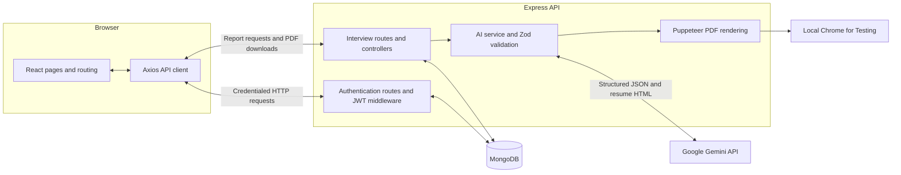
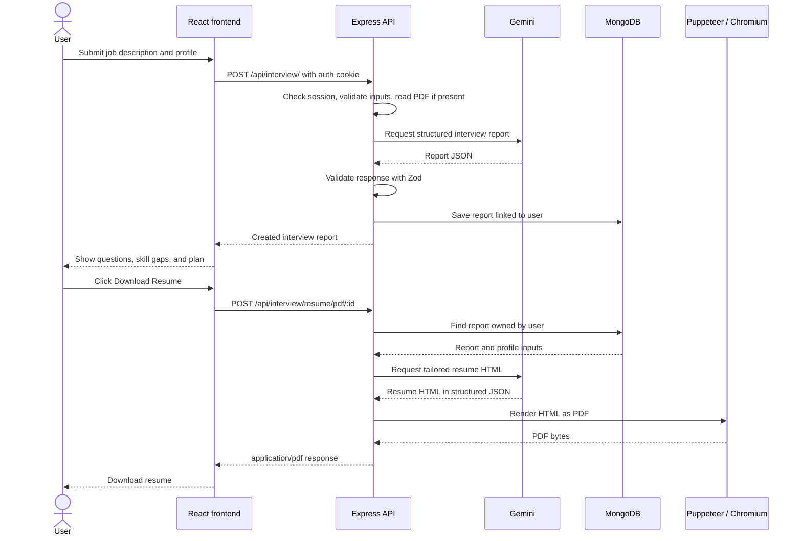

# IntervueX

**AI interview preparation with personalized questions, skill-gap analysis, preparation plans, and resume PDF export.**

IntervueX compares a job description with your PDF resume or self-description, then uses Google Gemini to generate an interview report. Reports are saved to your account so you can revisit them and generate a tailored resume.

[Repository](https://github.com/darshan-s-taskar/IntervueX) · [Installation](#installation) · [Architecture](#architecture) · [Project workflow](#project-workflow) · [Start and stop](#start-and-stop) · [Production deployment](#production-deployment) · [Troubleshooting](#troubleshooting)

## Features

- Register and log in with password hashing and JWT cookie authentication.
- Submit a job description with a PDF resume, a self-description, or both.
- Generate a match score, technical and behavioral questions, suggested answers, skill gaps, and a day-by-day preparation plan.
- View saved interview reports from your account.
- Generate and download a tailored resume as a PDF.
- Run MongoDB, the API, and the frontend together using the included Windows scripts.

Resume uploads support **PDF files up to 3 MB**. DOCX parsing and OCR for scanned resumes are not implemented. A job description and at least one profile input are required.

## Technology stack

| Layer | Technologies |
| --- | --- |
| Frontend | React 19, Vite 7, React Router 7, Axios, Sass |
| Backend | Node.js, Express 5 |
| Database | MongoDB, Mongoose 9 |
| Authentication | JSON Web Tokens, HttpOnly cookies, bcryptjs, token blacklist |
| AI generation | Google Gemini through `@google/genai` |
| Structured AI output | Zod 4 with native JSON Schema conversion |
| Resume upload and reading | Multer in-memory uploads, pdf-parse |
| PDF export | Puppeteer and Chrome for Testing |
| Checks | ESLint, Vite build, Node.js test runner, Puppeteer browser checks |

Exact dependency versions are recorded in the backend and frontend `package-lock.json` files. Installation uses those lockfiles.

## Architecture

The application has a React frontend and an Express API. MongoDB stores accounts, interview reports, and logged-out tokens. The backend handles Gemini requests and PDF rendering; private credentials stay on the server.



- **Frontend:** Auth and interview features each have pages, hooks, state/context, and API services. A shared Axios client sends requests with cookies. Protected routes require a signed-in user.
- **Backend:** Routes invoke controllers; middleware checks authentication and handles uploads. The AI service requests structured output, validates it with Zod, and renders resume HTML into PDF bytes.
- **Authentication:** Passwords are hashed with bcryptjs. Login and registration issue a JWT in an HttpOnly, SameSite=Lax cookie. Authenticated requests check the token and its blacklist status. Logout clears the cookie and records the token in MongoDB.
- **Data access:** Interview retrieval and resume export filter reports by the signed-in user's ID. Gemini keys, JWT secrets, and database credentials are backend environment settings.
- **Local processes:** Vite serves the frontend on port `5173`, Express listens on `3000`, and the default local MongoDB connection uses `27017`.

### Project structure

```text
IntervueX/
├── Backend/
│   ├── server.js                  # Environment loading, database connection, API startup
│   ├── .env.example               # Backend configuration template
│   ├── .puppeteerrc.cjs           # Project-local browser cache
│   ├── src/
│   │   ├── app.js                 # Express app, CORS, routes, health, error handling
│   │   ├── config/                # Database and cookie configuration
│   │   ├── controllers/           # Authentication and interview handlers
│   │   ├── middlewares/           # JWT authentication and file uploads
│   │   ├── models/                # Mongoose schemas
│   │   ├── routes/                # API route definitions
│   │   └── services/              # Gemini integration and PDF rendering
│   └── test/                      # Integration and startup checks
├── Frontend/
│   ├── .env.example               # Public API-origin configuration
│   ├── vite.config.js
│   └── src/
│       ├── api.js                 # Shared Axios client and request errors
│       ├── app.routes.jsx         # Application routes
│       └── features/
│           ├── auth/              # Login, registration, context, hooks, services
│           └── interview/         # Report creation, report pages, state, services
├── scripts/                       # Install, configure, start, stop, and verification tools
├── .gitignore
├── README.md
└── SETUP-REPORT.md                 # Development setup and verification history
```

Local setup also creates ignored directories: `.tools` for portable MongoDB, `.data` for database files, `.cache` for downloads, and `.runtime` for logs and managed process metadata. These directories are not supplied by a Git clone.

## Project workflow

1. **Sign in:** Register with a username, email, and password, or log in to an existing account. The backend sets an authentication cookie.
2. **Provide inputs:** Paste the target job description and upload a PDF resume or enter a self-description.
3. **Read the profile:** The backend verifies the session, validates the inputs, and extracts text from the PDF when one is supplied.
4. **Generate the report:** Gemini receives the job description and profile text. The backend requests structured JSON and validates the response with Zod.
5. **Save and display:** Mongoose saves the report with the user's ID. The frontend displays questions, answers, a match score, skill gaps, and a preparation plan.
6. **Revisit reports:** The home page lists saved reports; selecting one loads its full details from MongoDB.
7. **Export a resume:** Download Resume requests an export for an owned report. Gemini produces resume HTML, and Puppeteer uses local Chromium to return a PDF. Generated HTML runs with JavaScript disabled and external requests blocked.
8. **Log out:** The backend clears the cookie and blacklists the token.



Profile text and the job description are sent to Google when generating AI output. Review generated questions, scores, and resume content before relying on them. The resume prompt instructs Gemini to preserve supplied facts and omit or mark missing personal details.

## Installation

The commands below use **Windows PowerShell**, including the integrated terminal in VS Code. Run them from the repository root unless a step says otherwise.

### 1. Prerequisites

Install or make available:

- **Node.js 24 LTS** with npm: [official download](https://nodejs.org/en/download). Both packages declare Node.js `24.x`. Use the current patched Node 24 release on hosting platforms.
- **Git** to clone the repository: [official download](https://git-scm.com/downloads). Alternatively, download and extract the repository ZIP.
- **MongoDB:** choose a local Community Server or MongoDB Atlas, as explained below.
- **A Gemini API key:** create your own key in [Google AI Studio](https://aistudio.google.com/apikey).
- Internet access for package installation, Puppeteer's browser download, and Gemini requests.

Puppeteer downloads Chrome for Testing during backend dependency installation. You do not need a separate manual Chrome installation. The included process-management scripts are Windows-specific.

### 2. Clone the repository

```powershell
git clone https://github.com/darshan-s-taskar/IntervueX.git
Set-Location IntervueX
```

In VS Code, select **File > Open Folder**, open `IntervueX`, then choose **Terminal > New Terminal** and select PowerShell.

### 3. Install dependencies and create local environment files

```powershell
powershell -NoProfile -ExecutionPolicy Bypass -File .\scripts\install.ps1
```

This runs `npm ci` separately in `Backend` and `Frontend`, downloads Puppeteer's browser, and creates the following files if they are missing:

- `Backend/.env`, with a generated random JWT secret.
- `Frontend/.env`, with the local backend origin.

Existing environment files are preserved. The script does **not** install MongoDB. Stop any running IntervueX servers before reinstalling dependencies.

If you prefer to run the installation commands yourself:

```powershell
npm.cmd ci --prefix Backend
npm.cmd ci --prefix Frontend
node .\scripts\configure-env.cjs
```

### 4. Configure MongoDB

Choose one of these options.

#### Option A: Portable local MongoDB with the Windows launcher

1. Download a supported **MongoDB Community Server 8.0 Windows x64 ZIP** from the [official download page](https://www.mongodb.com/try/download/community). See the [Windows ZIP installation guide](https://www.mongodb.com/docs/v8.0/tutorial/install-mongodb-on-windows-zip/) for platform requirements.
2. Create `.tools` inside the project and extract the ZIP there. The resulting structure should contain `.tools/<mongodb-folder>/bin/mongod.exe`.
3. Keep this setting in `Backend/.env`:

   ```dotenv
   MONGO_URI=mongodb://127.0.0.1:27017/intervuex
   ```

The launcher finds `mongod.exe` under `.tools`, creates `.data/mongodb`, and starts the database on `127.0.0.1:27017`. It does not install a Windows service.

If you already run MongoDB as a service on port 27017, use the [manual startup](#manual-startup-in-separate-terminals) instructions instead. The all-in-one launcher intentionally refuses to take over an existing local database listener.

#### Option B: MongoDB Atlas

1. Create a project and cluster in [MongoDB Atlas](https://www.mongodb.com/cloud/atlas/register).
2. Create a database user and allow your laptop's public IP under Network Access.
3. Select **Connect > Drivers > Node.js** and copy the connection string.
4. Privately replace the credential placeholders, specify the database name `intervuex`, and save the URI as `MONGO_URI` in `Backend/.env`. Percent-encode special characters in the password.

For an Atlas URI, the Windows launcher starts the backend and frontend without starting portable MongoDB.

No seed script or initial data is required. Mongoose creates collections as needed. The schemas define unique username and email indexes, and each interview report references its user.

### 5. Configure the environment

Edit **`Backend/.env`** and **`Frontend/.env`**, not files named `Backend.env` or `Frontend.env`.

| Backend variable | Purpose | Default / setup |
| --- | --- | --- |
| `MONGO_URI` | MongoDB connection string | Local URI above, or your private Atlas URI |
| `JWT_SECRET` | Signs authentication tokens | Generated by the configuration script; at least 32 characters |
| `GOOGLE_GENAI_API_KEY` | Private Gemini API key | Add your own Google AI Studio key |
| `GEMINI_MODEL` | Model used for reports and resume HTML | `gemini-3-flash-preview` |
| `PORT` | API listening port | `3000` |
| `HOST` | API bind address | `127.0.0.1` |
| `FRONTEND_URL` | Allowed frontend origin for CORS | `http://localhost:5173` |

| Frontend variable | Purpose | Default |
| --- | --- | --- |
| `VITE_API_BASE_URL` | Optional development backend origin, without `/api`; production ignores this setting | Blank uses the Vite `/api` proxy to port 3000 |

Keep the generated JWT secret and paste your Gemini key privately after `GOOGLE_GENAI_API_KEY=`. Do not put backend secrets in any `VITE_` variable: those values are exposed to the browser. Environment files are ignored by Git; `.env.example` templates can be committed.

The configured model must be available to your Google project and support structured JSON output. Check Google's [model catalog](https://ai.google.dev/gemini-api/docs/models) and [API-key instructions](https://ai.google.dev/gemini-api/docs/api-key) if needed. Requests use your Google project quota and may incur charges depending on billing and model settings.

### 6. Start the application

```powershell
powershell -NoProfile -ExecutionPolicy Bypass -File .\scripts\start.ps1
```

Open **[http://localhost:5173](http://localhost:5173)** and register your own account.

| Service | Local address |
| --- | --- |
| Frontend | http://localhost:5173 |
| API health | http://localhost:3000/api/health |
| Local MongoDB | mongodb://127.0.0.1:27017/intervuex |

Check API readiness from PowerShell:

```powershell
Invoke-RestMethod http://localhost:3000/api/health
```

A ready backend returns HTTP 200 with `database: connected`. `geminiConfigured: true` means a key is present; it does not by itself verify that Google accepts the key or that quota is available. Submit an interview request to verify live generation.

## Start and stop

Run these commands from the repository root after installation and configuration.

| Action | PowerShell command |
| --- | --- |
| Start the managed services | `powershell -NoProfile -ExecutionPolicy Bypass -File .\scripts\start.ps1` |
| Stop the managed services | `powershell -NoProfile -ExecutionPolicy Bypass -File .\scripts\stop.ps1` |
| Restart only the backend | `powershell -NoProfile -ExecutionPolicy Bypass -File .\scripts\restart-backend.ps1` |

The scripts launch background processes. Closing VS Code or its terminal does not stop them; use the stop command. Database files remain in `.data/mongodb` after shutdown. Restart the backend to reload `Backend/.env`; stop/start the app after changing frontend environment settings.

If startup reports **"IntervueX processes are already running"**, open the local website, or run stop followed by start. The execution-policy flag applies only to the launched PowerShell process and does not change the machine's persistent policy.

Logs and managed process IDs are stored under `.runtime`:

```text
.runtime/backend.log
.runtime/backend.error.log
.runtime/frontend.log
.runtime/frontend.error.log
.runtime/mongodb.log
.runtime/mongodb.error.log
.runtime/processes.json
```

### Manual startup in separate terminals

Use this approach when you want foreground server logs or already manage MongoDB separately. Do not combine it with the background launcher.

For a portable local database, open a terminal at the repository root:

```powershell
New-Item -ItemType Directory -Path .data\mongodb -Force | Out-Null
$mongod = Get-ChildItem .tools -Recurse -Filter mongod.exe | Select-Object -First 1
& $mongod.FullName --dbpath .\.data\mongodb --bind_ip 127.0.0.1 --port 27017
```

Skip that command when using Atlas or an already running MongoDB service.

In a second terminal at the repository root, start the backend:

```powershell
npm.cmd --prefix Backend run dev
```

In a third terminal at the repository root, start the frontend:

```powershell
npm.cmd --prefix Frontend run dev
```

Open http://localhost:5173. Use **Ctrl+C** in each foreground server terminal to stop it, stopping the frontend and backend before a manually started MongoDB process. The backend also provides `npm.cmd --prefix Backend start` to run without watch mode.

## API reference

The frontend uses credentialed requests. Protected endpoints require the JWT cookie set by registration or login.

| Method | Endpoint | Authentication | Purpose |
| --- | --- | --- | --- |
| `GET` | `/api/health` | Public | Database readiness and Gemini configuration presence |
| `POST` | `/api/auth/register` | Public | Register with `username`, `email`, and `password` |
| `POST` | `/api/auth/login` | Public | Log in with `email` and `password` |
| `GET` | `/api/auth/get-me` | Required | Retrieve the current user |
| `POST` | `/api/auth/logout` | Authenticated cookie | Clear the session and blacklist the token |
| `POST` | `/api/interview/` | Required | Generate and save an interview report |
| `GET` | `/api/interview/` | Required | List the current user's reports |
| `GET` | `/api/interview/report/:interviewId` | Required | Retrieve an owned report |
| `POST` | `/api/interview/resume/pdf/:interviewReportId` | Required | Generate a PDF from an owned report |

Interview creation uses `multipart/form-data` with `jobDescription`, optional `selfDescription`, and optional `resume` PDF. At least one of `selfDescription` or `resume` must be supplied. Resume export returns `application/pdf`.

## Verification

From the repository root:

```powershell
npm.cmd --prefix Frontend run lint
npm.cmd --prefix Frontend run build
npm.cmd --prefix Backend test
```

Backend tests require a local MongoDB listener on `127.0.0.1:27017`, even if the application uses Atlas. They use real MongoDB and Chromium with **mocked Gemini**, create isolated `intervuex_setup_test_*` databases, and do not delete existing records or call Google. The frontend has lint/build scripts; it does not include a separate unit-test suite.

With the app running, check browser authentication and form behavior:

```powershell
node .\scripts\verify-browser.cjs
```

To test both live AI features with your configured key:

```powershell
node .\scripts\verify-browser.cjs --ai
node .\scripts\verify-live-export.cjs
```

Run those live commands in order. The first creates a test account and generates a report. The second uses that account, clicks Download Resume, verifies PDF bytes and text, and saves `output/pdf/intervuex-live-test-resume.pdf`. Live checks use Google API quota. Random test-account credentials are stored only in ignored `.runtime/verification-account.json`.

Local verification has covered authentication, report ownership, PDF parsing/export, startup failure handling, and live Gemini generation. See [SETUP-REPORT.md](SETUP-REPORT.md) for the recorded results and known dependency audit findings.

## Troubleshooting

| Problem | What to check |
| --- | --- |
| Processes are already running | Open http://localhost:5173, or run the stop command before starting again. |
| Port 27017 is occupied | An existing MongoDB may already be running. Use manual frontend/backend startup to connect to it, or stop your previously managed IntervueX services. |
| MongoDB will not connect | Verify `MONGO_URI`, the database process, and `.runtime` logs. For Atlas, check database-user credentials and the IP access list. Do not delete `.data` as a troubleshooting step. |
| Backend will not start | Confirm Node compatibility, MongoDB availability, and a JWT secret of at least 32 characters. Inspect backend logs. |
| Frontend cannot reach the backend | Match `VITE_API_BASE_URL` to the backend port. Use `http://localhost:5173` consistently and match `FRONTEND_URL` exactly. |
| Login does not persist | Check cookie/CORS settings and clear stale localhost cookies if the JWT secret was changed. |
| Gemini generation fails | Check the private key, model availability, network access, project quota, and billing. Without a key, authentication still works but generation returns a configuration error. |
| Resume upload fails | Use a text-based PDF under 3 MB or provide a self-description. DOCX and OCR are not supported. |
| PDF export cannot find Chrome | From `Backend`, run `node node_modules/puppeteer/install.mjs` with internet access to restore the project-local browser download. |
| PowerShell blocks `npm.ps1` | Use `npm.cmd`, as shown in this guide. |
| Dependency audit reports advisories | Review the recorded findings and compatibility before upgrading. Avoid applying `npm audit fix --force` without testing. |

## Production deployment

Deployment configuration is prepared for **GitHub + Render (API) + Vercel (frontend) + MongoDB Atlas**. See [DEPLOYMENT-REPORT.md](DEPLOYMENT-REPORT.md) for account actions, environment settings, verification evidence, current deployment status, and redeployment instructions. Configuration files alone do not mean the application has been deployed.

```text
Browser -> https://<frontend>.vercel.app/api/* -> Render Express API
                                               |-> MongoDB Atlas
                                               |-> Google Gemini
                                               |-> Chromium PDF renderer
```

- **Render:** use root `Backend`, Docker runtime, `Dockerfile`, and build context `.` relative to that root. The image runs `npm ci --omit=dev` and starts with `npm start`, listening on `0.0.0.0:$PORT`. `render.yaml` prepares a Free service with automatic deploys disabled. Do not select paid resources without approval. Free hosting is a preview starting point; PDF memory usage and cold starts require live verification.
- **Vercel:** use root `Frontend`, framework Vite, Node 24.x, install `npm ci`, build `npm run build`, output `dist`. Set the non-secret `BACKEND_ORIGIN` to the actual Render HTTPS origin. `Frontend/vercel.ts` evaluates that variable at configuration time, proxies `/api/*`, and serves the SPA on nested page routes. Do not set `VITE_API_BASE_URL` in production.
- **Secrets:** enter `MONGO_URI`, `JWT_SECRET`, and `GOOGLE_GENAI_API_KEY` directly in Render's Environment page. Keep them out of Git, chat, screenshots, build output, and all `VITE_` variables. Set `FRONTEND_URL` to the exact HTTPS Vercel production origin with no trailing slash. Cookies are host-only, HttpOnly, Secure in production, and SameSite=Lax. The proxy makes browser API calls same-origin.
- **Abuse controls:** login/registration allow 30 attempts per IP per 15 minutes; AI endpoints allow 10 attempts per account per hour and one concurrent generation per API process. These counters are in memory. Use Google project quota controls as an additional limit. Do not enable billing during setup.
- **PDF isolation:** the Docker image includes Linux libraries, fonts, and a matching Chrome download. Chrome runs as a non-root user with its host sandbox disabled inside the Render container. AI HTML has JavaScript, remote requests, and local file loads blocked; PDF rendering and AI calls have timeouts.

Before publishing, run `node scripts/audit-security.cjs` with the verified Gitleaks binary in ignored `.tools/gitleaks`, review `git status`, and rerun the backend tests plus frontend lint/build. Local environment files, database files, caches, logs, uploads, and generated resumes stay ignored. Only credential-free `.env.example` templates belong in Git.

After the actual URLs are available, run:

```powershell
node scripts/verify-deployment.cjs https://<actual-frontend-origin> --ai
```

This uses the public frontend and its API proxy to test registration, login/logout, cookie persistence, dashboard, live Gemini generation, saved-report retrieval, nested-route refresh, and readable PDF download. It makes two Gemini requests and retains a synthetic test account/report. Private evidence is saved under ignored `.runtime/deployment-*`. A successful local run with `--local` is separate from a successful deployment test.

## Acknowledgements and licensing

IntervueX is based on [interview-ai-yt by ankurdotio](https://github.com/ankurdotio/interview-ai-yt), with local setup fixes, IntervueX branding, configuration improvements, and verification scripts. The original backend's `ISC` package license declaration is retained. The upstream repository did not provide a root LICENSE file or copyright notice when inspected on 7 November 2026; this repository does not invent one. Confirm the applicable upstream license text and attribution before adding a project-wide license.
